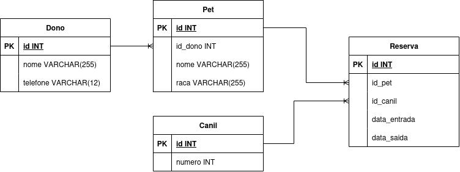

# Desafio Desenvolvedor Full Stack Jr.

## Como o sistema era:

O sistema apresentava a seguinte estrutura de persistência de dados:

```json
{
  "id_reserva": 901,
  "nome_do_dono": "Carlos Almeida",
  "telefone_dono": "11999999999",
  "nome_do_pet": "Rex e Bolinha",
  "raca_do_pet": "Labrador e Poodle",
  "data_entrada": "2023-11-10",
  "data_saida": "2023-11-15",
  "numero_do_canil": 5,
  "valor_total_pago": 350.0
}
```

Esse armazenamento é muito utilizado em Sistemas NoSQL como MongoDB, em que os dados são armazenados como documentos. Porém o principal prolema desse modelo é que ele dificulta a busca e viola princípios do ACID (Atomicidade, Consistência, Isolamento e Durabilidade) para esse caso de uso, já que uma mesma estrutura armazena dados de reserva, pet e dono. Logo, diante de questões como:

- **O que acontece se o Carlos mudar de telefone?**

  Se Carlos mudar de telefone, o sistema vai ter que procurar todas as Reservas que tenham o campo 'nome_do_dono' igual a Carlos e vai ter que alterar o atributo 'telefone_dono' em cada uma delas, o que não é nem um pouco eficiente se comparar com um esquema de dados relacional, em que uma tabela só armazenaria os dados de Cliente, e permitiria a mudança de telefone com bem mais eficiência.

- **Como o sistema lidaria com a busca pelo histórico médico do “Rex” individualmente?**

  A busca pelo histórico individual de Rex seria bem menos eficiente nesse cenário, pois o campo 'nome_do_pet' teria não só que ser pesquisado em cada reserva, mas teria que ser tratado já que pode haver o nome de até dois pets nesse atributo. Bem menos eficiente do que se cada reserva só pudesse ser de um Pet, caso esse em que um esquema de dados relacionais teria restrições explícitas a esse acontecimento, impedindo que uma mesma reserva seja atribuída a dois pets.

## Proposta do Sistema

Para o sistema implementado, os dados serão armazenados no MySQL, sistema em que os dados são organizados de forma estruturada e com integridade referencial. O Esquema ER está representado na figura:



### Entidades

- **Dono**: Armazena informações dos proprietários dos pets
  - `id`: Identificador único
  - `nome`: Nome do proprietário
  - `telefone`: Telefone de contato

- **Pet**: Armazena informações dos pets
  - `id`: Identificador único
  - `id_dono`: Referência ao proprietário
  - `nome`: Nome do pet
  - `raca`: Raça do pet

- **Canil**: Armazena informações dos canis disponíveis
  - `id`: Identificador único
  - `numero`: Número do canil
  - `valor_diario`: Valor da diária

- **Reserva**: Armazena as reservas realizadas
  - `id`: Identificador único
  - `id_pet`: Referência ao pet
  - `id_canil`: Referência ao canil
  - `data_entrada`: Data de entrada do pet
  - `data_saida`: Data de saída do pet

### Restrições de Negócio

- Uma reserva só pode conter um único pet
- Um proprietário pode ter no máximo 2 pets do mesmo canil no mesmo período
- Cada pet não pode ter reservas com datas conflitantes
- Reservas devem ser criadas para o futuro (a partir de amanhã)
- Uma reserva que ainda está ocorrendo não pode ser excluída nem editada no sistema

## Como executar

### Pré-requisitos

Certifique-se de que em sua máquina tenha o Runtime do Node na versão 24:

```bash
node -v  # Deve retornar v24.x.x
```

### Configuração Inicial

**1. Instale as dependências** em cada pasta:

```bash
cd backend && npm install
cd ../database && npm install
cd ../petzin-frontend && npm install
```

**2. Crie arquivos `.env`** nas pastas `/database` e `/backend`:

```bash
# Na pasta /database
cp .env.example .env

# Na pasta /backend
cp .env.example .env
```

**Importante**: Certifique-se que as variáveis de ambiente nos dois arquivos `.env` têm os mesmos valores (especialmente `DB_HOST`, `DB_PORT`, `DB_USER`, `DB_PASSWORD`).

### Iniciando o Sistema

**3. Inicie o container MySQL** (na pasta `/database`):

```bash
npm run load:db
```

Aguarde até que o MySQL esteja totalmente iniciado e aceitando conexões.

**4. Execute as migrations** (na pasta `/database`, com MySQL rodando):

```bash
npm run db:migrate
```

**5. Inicie o backend** (em um terminal, na pasta `/backend`):

```bash
npm start
```

Backend rodará em: `http://localhost:3000`

**6. Inicie o frontend** (em outro terminal, na pasta `/petzin-frontend`):

```bash
npm run dev
```

Frontend rodará em: `http://localhost:5173` ou `http://localhost:5174`

### Acessando a Aplicação

Abra seu navegador e acesse: **http://localhost:5173**

A aplicação estará disponível com todas as 3 páginas:

- `/clientes` - Gerenciamento de clientes e pets
- `/criar-reserva` - Formulário de criação de reservas
- `/reservas` - Gerenciamento e filtragem de reservas

## Tecnologias

- Frontend
  - React - Dependência para Single Page Application;
  - React Hook Form - Dependência que facilita o gerenciamento de estado em formulários;
  - Shadcn/UI - Dependência com componentes prontos e de fácil customização;
  - Axios - Dependência que gerencia requisições HTTP entre a aplicação web e sistemas externos;
  - Tailwind - Dependência com estilos CSS prontos.
  - React Query - Dependência que facilita o gerenciamento de estados globais e a reatividade da aplicação, com utilitários para caching e refetching.

- Backend
  - Express - Framework não opinativo para APIs REST;
  - Sequelize - ORM (Object-Relational Mapping) para o MySQL. Sua vantagem é possibilitar o gerenciamento dos dados em Javascript;
  - Zod - Validação de Requisições
  - Mysql2 - Permite conexões seguras entre o Backend e o Banco de dados

- Database
  - MySQL - Sistema de gerenciamento de banco de dados relacional.
  - Docker - Ideal para rodar sistemas de forma isolada e padronizada independente da máquina ou do Sistema Operacional do host.
